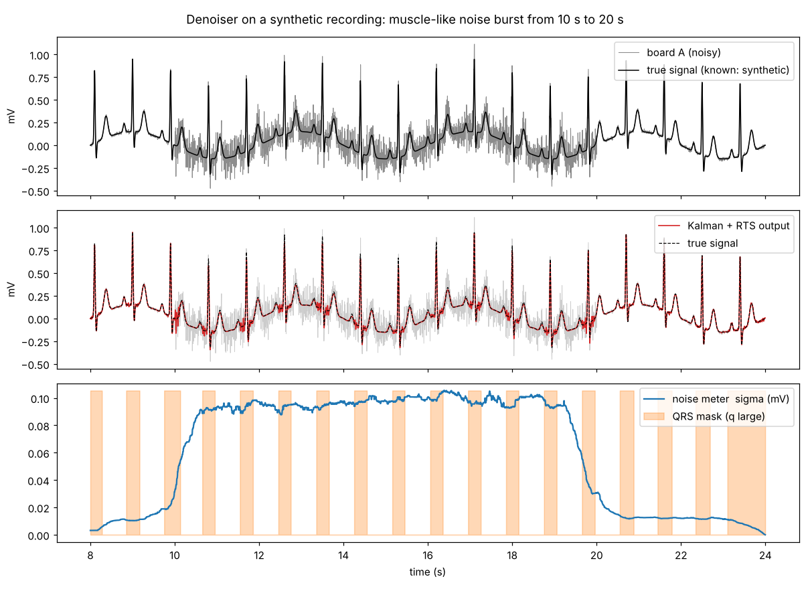
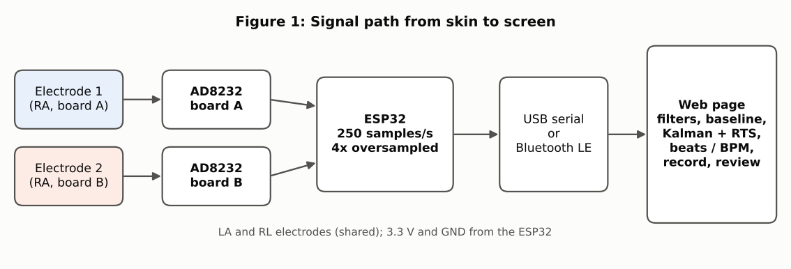
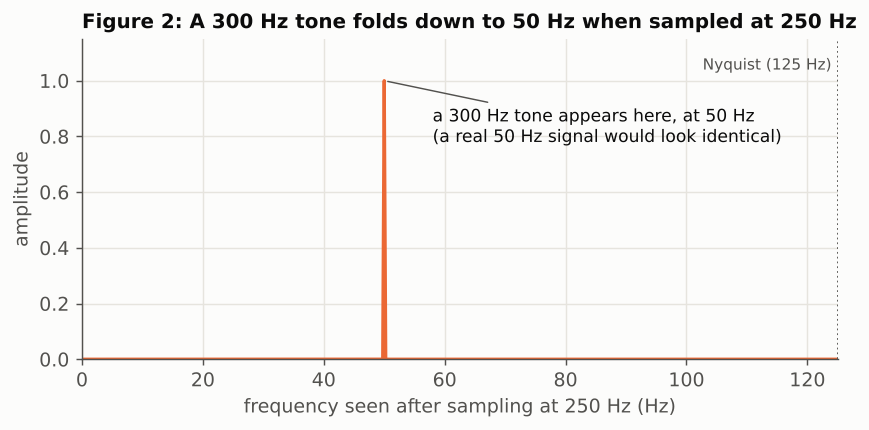
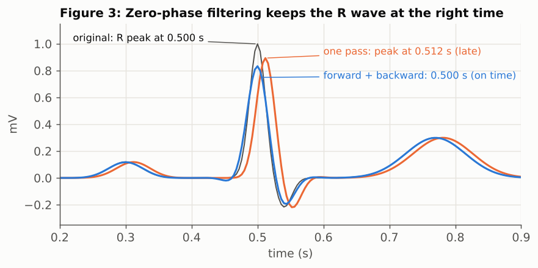
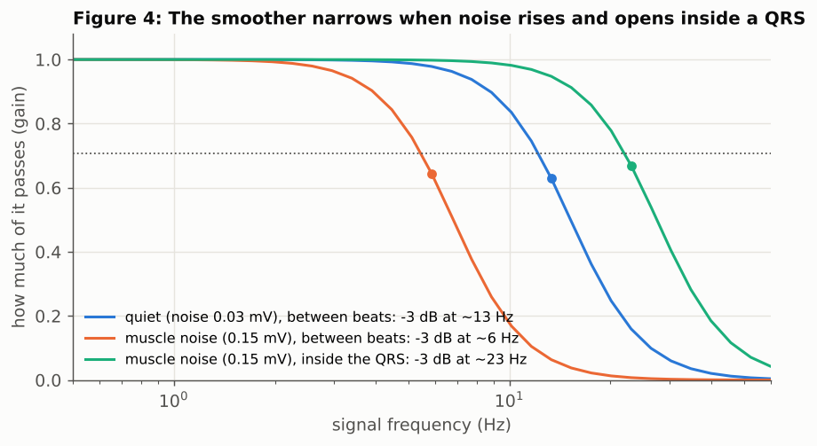
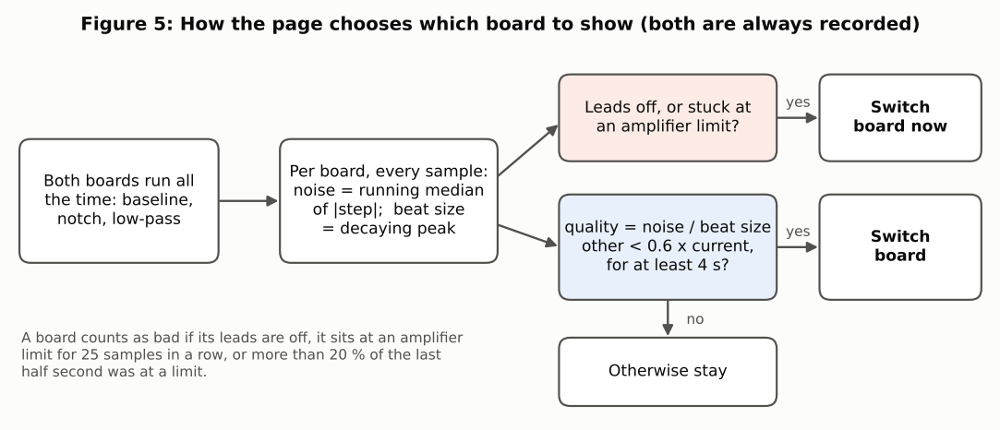
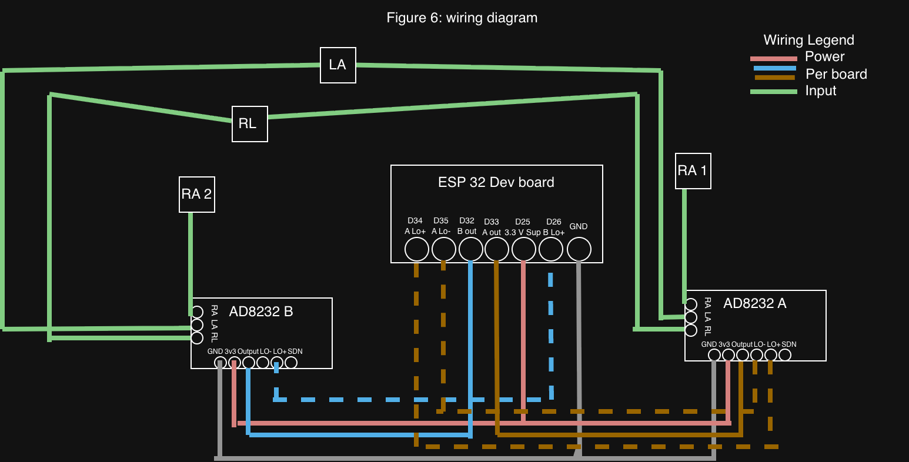
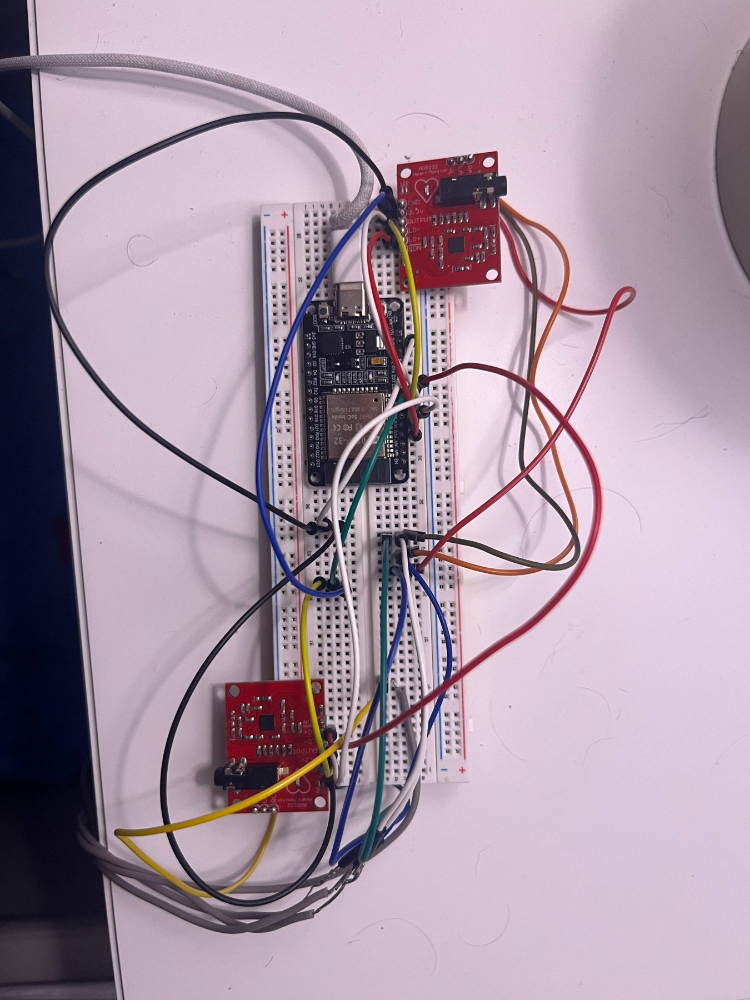
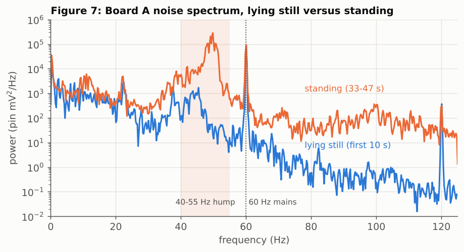
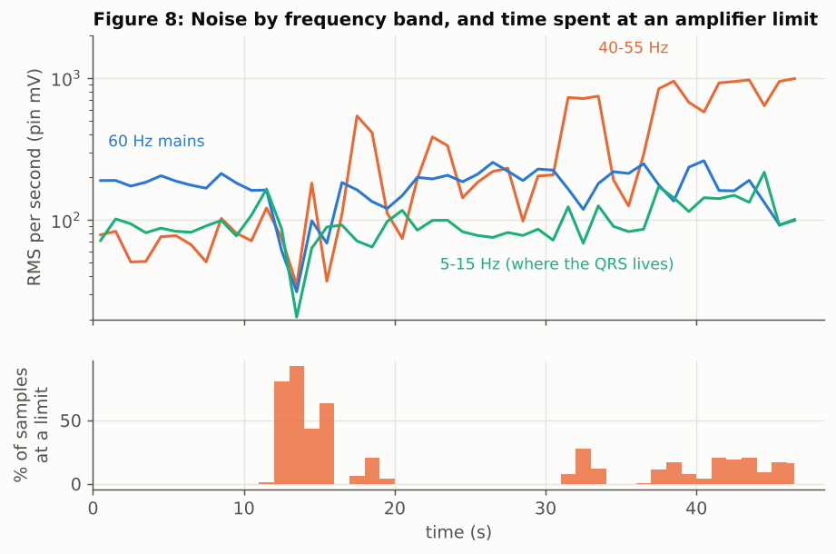

# Motion-Robust Wearable ECG

A single-lead wearable ECG built from an ESP32 and AD8232 boards, plus a browser monitor and a signal-processing pipeline written from scratch to keep the trace readable while the wearer moves.



*Figure 0: The denoiser on a synthetic recording. Grey is the noisy input, colour is the cleaned output. Real recordings are not in this repo for privacy.*

> **Not a medical device.** This is a learning and portfolio project. It has not been validated against clinical equipment and must not be used to diagnose or monitor any condition.
>
> Want the math? Read [docs/MATH.md](docs/MATH.md). Want the honest results? Read [docs/RESULTS.md](docs/RESULTS.md).

## Table of Contents

- [Description](#description)
- [Features](#features)
- [My Contribution](#my-contribution)
- [Results and Limitations](#results-and-limitations)
- [How to Run It](#how-to-run-it)
- [Repository Layout](#repository-layout)
- [Roadmap](#roadmap)
- [Authorship and AI Assistance](#authorship-and-ai-assistance)
- [Author Info](#author-info)
- [License](#license)

## Description

### Why a clean single lead matters

An electrocardiogram (ECG) records the heart's electrical activity through electrodes on the skin. Doctors spot irregularities, such as arrhythmias, by reading the timing and shape of each beat. That works best if the trace is clean. When the wearer walks, stands up, or tenses their muscles, motion and muscle noise can bury the beats entirely, and a monitor that goes blank during movement might miss crucial data. 

### What this project is

I wanted a wearable that keeps a continuous single-lead trace even while the wearer moves. The approach has two halves:

1. **Hardware redundancy.** Two AD8232 boards with separate electrodes record at the same time, so if one fails, the other may still be good.
2. **Software that adapts to noise.** A browser page filters each board, estimates how noisy it is, smooths the trace more when it is noisy and less during the sharp QRS spike, and switches to the better board automatically.

Everything is documented in a teaching style because the other goal of the project is for me to understand every equation in it.

[Back To The Top](#motion-robust-wearable-ecg)

## Features

- **ESP32 + AD8232 acquisition** at 250 samples per second with 4x oversampling, over USB serial or Bluetooth LE.
- **Two-board mode** with automatic selection of the cleaner board, and handling for leads-off and amplifier saturation.
- **Web monitor** (one HTML file, no install) with live trace, heart rate, recording to CSV, and review mode.
- **Filter chain:** baseline removal, 60 Hz notch, low-pass, all as biquads, plus zero-phase filtering for review.
- **Noise-adaptive Kalman smoother** with an RTS backward pass, whose bandwidth narrows with noise and opens inside the QRS.
- **Beat detection and BPM** in the Pan-Tompkins style.
- **A Python reference implementation** of the denoiser with tests, including a test that checks the browser's JavaScript gives the same answers.
- **MATLAB scripts and data export** for exploring real recordings.



*Figure 1 (above) is the full signal path. Each box is explained in [docs/MATH.md](docs/MATH.md).*

[Back To The Top](#motion-robust-wearable-ecg)

## My Contribution

This section is a first-person log of what I did and what I learned. It is the part I most want a reader to see.

### 1. Getting a signal at all

The AD8232 outputs an analog voltage centred at half the supply, with a gain of about 1100. The ESP32 reads it with its ADC. The first lesson was which pins to use: the ESP32's ADC2 pins stop working for analog reads when WiFi or Bluetooth is on, so I moved everything to ADC1 pins (32, 33, 34, 35, 36, 39). Details are in [docs/HARDWARE.md](docs/HARDWARE.md).

### 2. Understanding sampling and aliasing

Sampling at 250 Hz means anything above 125 Hz folds back into the visible range. The ESP32 has no anti-alias filter in front of its ADC, so interference above 125 Hz can appear as a false signal below it. A 300 Hz tone shows up at 50 Hz, as Figure 2 shows.



*Figure 2: Aliasing. I have not yet tested whether this explains the 40-55 Hz noise I see while standing; see the limitations below.*

### 3. Filtering without moving the beat

A filter that runs once in one direction delays the signal. For review I run each filter forward then backward, which cancels the delay so the R wave stays at the right time (Figure 3). This cannot be done live, because it needs future samples, so live mode uses a short delay instead.



*Figure 3: One pass delays the R peak by 12 ms. Forward plus backward does not.*

### 4. A smoother that adapts to noise

The central idea is a Kalman smoother that treats the clean trace as a smooth curve observed through noise. How hard it smooths depends on a noise estimate, and a mask for the QRS tells it to relax there so the spike is not flattened. Figure 4 shows the measured bandwidth for three situations.



*Figure 4: The -3 dB bandwidth is about 13 Hz when quiet, 6 Hz in muscle noise between beats, and 23 Hz inside the QRS.*

### 5. Choosing between two boards

Both boards are always recorded. The page scores each by noise divided by beat size and switches when the other is clearly better for a few seconds. A bad board (leads off or stuck at an amplifier limit) triggers an immediate switch. My first version switched 118 times in one test recording because it reacted to every brief rail hit; adding averaging and a minimum dwell time brought that to 8.



*Figure 5: The board-selection logic. The thresholds are my own guesses and have not been tuned on enough data.*

### 6. Wiring


*Figure 6A : Wire diagram of two-board prototype.*


*Figure 6b : Photo of the two-board prototype.*

Sharing the right-leg (RL) electrode between boards is fine. Sharing the left-arm (LA) electrode made both boards fail together in my test, with a correlation of 0.96 while standing, so each board should have its own LA.

### 7. The test that did not go well

I recorded a short test: lying still, tapping the electrodes, then standing up around 30 seconds in. Tapping did not trigger a false switch, and the rhythm looked similar to ventricular tachycardia, giving me the confidence in the device still working under arrithmia. When I stood up, the beats were mostly lost, with gaps of about three seconds. Figure 7 shows why: interference between 40 and 55 Hz rose by orders of magnitude, and Figure 8 shows the amplifier hitting its limits.



*Figure 7: Noise spectrum for board A, lying still versus standing. The big 40-55 Hz hump while standing is unexplained.*



*Figure 8: Noise by band over the recording, and the share of samples stuck at an amplifier limit. Software cannot recover beats that are buried this deep; this is a hardware problem.*

What I took from it: the software behaved as designed, but no filter helps when the signal is saturated. The next steps are hardware, listed in the roadmap.

[Back To The Top](#motion-robust-wearable-ecg)

## Results and Limitations

- The denoiser is tested on synthetic data with 10 automated tests, including parity between the Python and JavaScript versions.
- On real recordings while lying still, beats are clear. While standing, they are not.
- Rest noise on one day was roughly 10-20 times higher than on another day. I have not isolated why. The suspects are the way in which the board is powered from a GPIO pin, loose wiring, reused electrodes, and a shared LA electrode.
- Board-selection thresholds are guesses.
- It is single-lead and has no clinical validation.

More detail is in [docs/RESULTS.md](docs/RESULTS.md).

[Back To The Top](#motion-robust-wearable-ecg)

## How to Run It

**Web monitor.** Open `web/ecg_monitor.html` in Chrome or Edge. Connect over USB serial, or over Bluetooth to the device named `ECG-ESP32`. With no hardware, load `data/synthetic_two_board.csv`.

**Python reference and tests.**

```bash
pip install -r requirements.txt
cd analysis
python demo_denoise.py          # makes the denoise figure
python -m pytest tests          # 10 tests
python make_figures.py          # regenerates images/
```

**Firmware.** Open one of the sketches in `firmware/` in the Arduino IDE. Pin tables are in [docs/HARDWARE.md](docs/HARDWARE.md).

**MATLAB.** See `analysis/matlab/` and [docs/LEARNING_PATH.md](docs/LEARNING_PATH.md).

[Back To The Top](#motion-robust-wearable-ecg)

## Repository Layout

| Path | What it holds |
|---|---|
| `web/` | The browser monitor |
| `firmware/` | ESP32 sketches (USB, BLE, two-board) |
| `analysis/` | Python reference denoiser, tests, figure scripts |
| `analysis/matlab/` | MATLAB versions of the filters and Kalman smoother |
| `docs/` | Math, results, hardware notes, learning path |
| `images/` | Figures used in this README |
| `data/` | Synthetic data only |

[Back To The Top](#motion-robust-wearable-ecg)

## Roadmap

- Give each board its own LA electrode and re-test standing.
- Record on battery to rule out power-supply noise.
- Test an anti-aliasing filter and 1 kHz sampling.
- Add a marker button and an accelerometer for motion reference.
- Flag rhythm irregularities and benchmark on the MIT-BIH database.
- Gate BPM on signal quality.

[Back To The Top](#motion-robust-wearable-ecg)

## Authorship and AI Assistance

<!-- EDIT THIS so it is exactly true. -->
I designed the experiments, built and wired the hardware, and collected all recordings. The firmware, web page, analysis code and documentation were written with substantial help from an AI assistant (Anthropic's Claude), working from my requirements and data. I am working through the underlying math using [`docs/LEARNING_PATH.md`](docs/LEARNING_PATH.md), and the test suite checks the code against the math.

[Back To The Top](#motion-robust-wearable-ecg)

## Author Info

- Name: `Aiden Sorrels`
- LinkedIn: `<your link>`
- GitHub: `<your link>`

[Back To The Top](#motion-robust-wearable-ecg)

## License

MIT. See [LICENSE](LICENSE).
